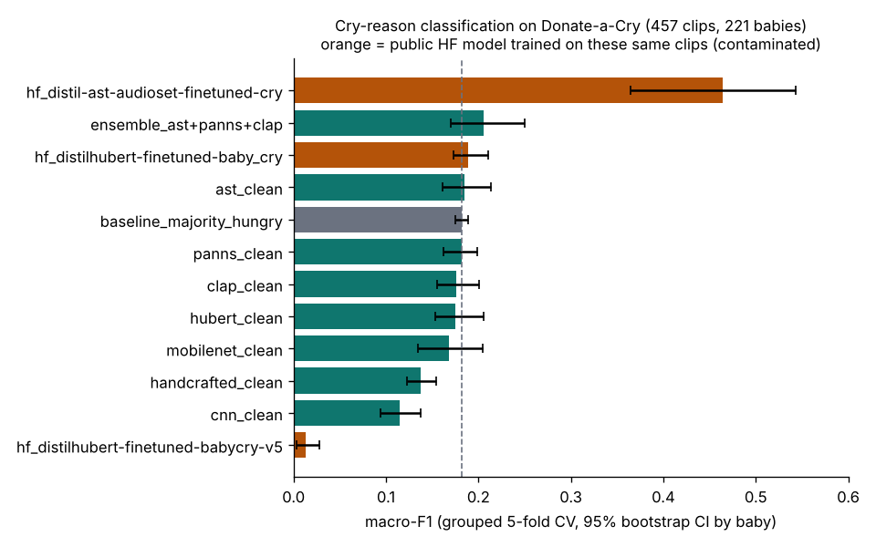

# 03 — Comparing the approaches (Phase 3–4)

**Evaluation protocol (identical for every approach):** the 457 clips of the cleaned Donate-a-Cry set, **5-fold Stratified-Group CV by baby (app uuid)**.
Every clip gets a prediction from a model that never saw that baby. Hyperparameters and temperature calibration are tuned with an inner CV inside the training folds only.
95% confidence intervals: bootstrap **by baby** (1,000 resamples). Raw predictions for each approach: `results/raw/<approach>.jsonl`. Confusion matrices: `results/confusion_matrices/`.

## Main table

| # | Approach | macro-F1 [95% CI] | macro-AUC | Balanced acc. | Plain acc. | Top-2 | Latency/clip* | Audio leaves the device? |
|---|---|---|---|---|---|---|---|---|
| — | **Baseline: always "hungry"** | **0.182** [0.175–0.189] | 0.500 | 0.200 | 0.836 | 0.871 | 0 | — |
| G | Ensemble AST+PANNs+CLAP | 0.206 [0.170–0.250] | 0.487 | 0.206 | 0.746 | 0.873 | ~2.4 s | no |
| C | AST embeddings + LR | 0.185 [0.161–0.214] | 0.514 | 0.184 | 0.652 | 0.840 | 629 ms | no |
| C | PANNs Cnn14-16k + LR | 0.182 [0.163–0.199] | 0.483 | 0.182 | 0.646 | 0.818 | 114 ms | no |
| C | CLAP + LR | 0.176 [0.155–0.201] | 0.494 | 0.177 | 0.615 | 0.812 | 1.65 s | no |
| C | HuBERT-base + LR | 0.175 [0.153–0.205] | 0.480 | 0.170 | 0.604 | 0.825 | 1.96 s | no |
| C | **PANNs MobileNetV1 + LR (in the web app)** | 0.168 [0.135–0.205] | 0.518 | 0.187 | 0.431 | 0.713 | **7 ms (ONNX)** | **no (runs on the phone)** |
| — | Hand-crafted features (MFCC, F0, rhythm) + LR | 0.137 [0.122–0.154] | 0.400 | 0.121 | 0.446 | 0.726 | ~300 ms | no |
| D | Small CNN (160k params) on log-mel, from scratch + augmentation | 0.115 [0.094–0.137] | 0.420 | 0.130 | 0.274 | 0.689 | <10 ms | no |
| E | HF `distilhubert-finetuned-baby_cry` ⚠️ | 0.189 [0.173–0.211] | 0.499 | 0.196 | 0.790 | 0.888 | 768 ms | no |
| E | HF `distilhubert-finetuned-babycry-v5` ⚠️ | 0.014 | 0.490 | 0.200 | 0.035 | 0.088 | 655 ms | no |
| E | HF `distil-ast-audioset-finetuned-cry` ⚠️⚠️ | 0.465 [0.364–0.543] | 0.921 | 0.779 | 0.505 | 0.626 | 7.0 s | no |
| B | HeAR + classifier | **not run** — gated model, needs an HF token and acceptance of the HAI-DEF terms | | | | | | |
| A / A2 | Gemini Decision 1 zero/few-shot | **not run** — OpenRouter balance is 0 (402). Script ready: `src/online_eval.py` | | | | | | yes (Google) |
| F | Audio LLM (Gemini 4 Hydrogen…) ×3 | **not run** — same reason | | | | | | yes |

\* CPU, 4 cores, shared with other jobs while measuring, so these are approximate figures.

⚠️ **The HF models were trained on copies of Donate-a-Cry (`Nooon/Donate_a_cry`)**, so our clips are part of their training data and their scores **are not a fair test**.
- `distil-ast` gets an AUC of 0.92 on these clips, which is **memorisation** of the training data. Its own model card reports 63.6% accuracy on its eval split, below the 83.6% majority baseline.
- The two distilhubert models collapsed to a single class ("hungry" or "belly_pain") **even on their own training data**.

## Per class (best leakage-free approach, AST)
| Class | F1 | One-vs-rest AUC |
|---|---|---|
| hungry | 0.80 | 0.53 |
| discomfort | 0.09 | 0.65 |
| belly_pain | 0.00 | 0.36 |
| burping | 0.00 | 0.63 |
| tired | 0.03 | 0.41 |

"discomfort" is the only class that showed a weak, consistent hint (AUC 0.64–0.65 in AST, PANNs and MobileNet), but it rests on 27 clips from 16 babies, so its confidence interval is wide.

## Abstention ("uncertain")
After calibration, the probabilities are almost flat (the fitted temperature is often 2 to 4, i.e. the models are overconfident before calibration).
Example for AST: at a confidence threshold of 0.7 only **38%** of clips are covered, with 79% accuracy. **That is below the majority baseline of 83.6%**, so the abstention adds no real value here. The web app shows "uncertain" whenever the top probability is under 50%, which is almost always the case, and that is the honest outcome.

## Sanity checks
1. **Positive control** (`results/positive_control.json`): the same pipeline, the same embeddings and the same grouped split **learn the baby's age** (0–4 weeks vs ≥ 7 months) with AUC 0.63–0.70, but get **0.44–0.52 for "hungry vs the rest"**. So the code works, and the reason labels in this data carry no transferable acoustic signal.
2. **Leakage** (`results/leakage_check.json`): a random clip-level split instead of a by-baby split raises AST from 0.21 to **0.28** macro-F1. Clips from the same baby are more similar to each other (cosine 0.92 vs 0.89). This is the source of the 60–90% numbers in blogs and Kaggle notebooks, plus accuracy being dominated by the "hungry" class at 84%.
3. **Internal vs YouTube gap:** could not be measured. The YouTube set was not built (download blocked). See 02.
